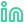

<picture>
  <source media="(prefers-color-scheme: light)" srcset="./assets/profile-banner-light.svg">
  
</picture>
 

  

  
<picture><source media="(prefers-color-scheme: light)" srcset="./assets/metrics-light.svg"></picture>
  
<picture><source media="(prefers-color-scheme: light)" srcset="./assets/terminal-light.svg"></picture>
 
<picture><source media="(prefers-color-scheme: light)" srcset="./assets/divider-light.svg"></picture>

## About
I’m **Muhammad Suleiman**, a software developer building full-stack web applications with React, Node.js, and PostgreSQL. I’m currently deepening my knowledge of backend architecture, APIs, and authentication, and I also work on video editing and visual design.

I enjoy turning ideas into real projects and improving my skills one step at a time.

## Engineering Focus

  <picture><source media="(prefers-color-scheme: light)" srcset="./assets/engineering-focus-light.svg"></picture>

<picture><source media="(prefers-color-scheme: light)" srcset="./assets/divider-light.svg"></picture>

## Selected Projects

<a href="https://scholarlog.online"><picture><source media="(prefers-color-scheme: light)" srcset="./assets/project-scholarlog-light.svg"></picture></a>
 
<a href="https://sudeys-graphix.vercel.app"><picture><source media="(prefers-color-scheme: light)" srcset="./assets/project-sudeys-graphix-light.svg"></picture></a>
 
<a href="https://prime-shoplify.vercel.app"><picture><source media="(prefers-color-scheme: light)" srcset="./assets/project-prime-shoplify-light.svg"></picture></a>
 
<a href="https://deprimus.vercel.app"><picture><source media="(prefers-color-scheme: light)" srcset="./assets/project-portfolio-light.svg"></picture></a>
 
<a href="https://nurudeen-schools.vercel.app"><picture><source media="(prefers-color-scheme: light)" srcset="./assets/project-nurudeen-schools-light.svg"></picture></a>

See everything in <a href="https://deprimus.vercel.app">the portfolio</a>.

<picture><source media="(prefers-color-scheme: light)" srcset="./assets/divider-light.svg"></picture>

  <picture><source media="(prefers-color-scheme: light)" srcset="./assets/pipeline-light.svg"></picture>

<picture><source media="(prefers-color-scheme: light)" srcset="./assets/divider-light.svg"></picture>

## Technology Stack

  <picture><source media="(prefers-color-scheme: light)" srcset="./assets/tech-stack-light.svg"></picture>

<picture><source media="(prefers-color-scheme: light)" srcset="./assets/divider-light.svg"></picture>

## Currently Building / Learning
- **Full-stack applications:** building complete web apps from frontend to backend.
- **React:** exploring advanced patterns and better state management.
- **Node.js / Express:** working with APIs, authentication, and real-world systems.
- **PostgreSQL:** learning database design, optimization, and data modeling.
- **System design:** understanding how to build scalable and maintainable systems.

## GitHub Activity

<picture>
  <source media="(prefers-color-scheme: dark)" srcset="https://raw.githubusercontent.com/deprimus01/deprimus01/output/github-snake-dark.svg" />
  <source media="(prefers-color-scheme: light)" srcset="https://raw.githubusercontent.com/deprimus01/deprimus01/output/github-snake.svg" />
  
</picture>
  
<picture><source media="(prefers-color-scheme: light)" srcset="./assets/stats-light.svg"></picture>
  
<picture><source media="(prefers-color-scheme: light)" srcset="./assets/langs-light.svg"></picture>

### Recently active
<!-- RECENT:START -->
- _This list fills in automatically after the first workflow run._
<!-- RECENT:END -->

<picture><source media="(prefers-color-scheme: light)" srcset="./assets/divider-light.svg"></picture>

  <a href="mailto:deprimus01@gmail.com"><picture><source media="(prefers-color-scheme: light)" srcset="./assets/contact-light.svg"></picture></a>

## Connect
- <picture><source media="(prefers-color-scheme: light)" srcset="./assets/icons/globe-light.svg"></picture> **Portfolio:** [deprimus.vercel.app](https://deprimus.vercel.app)
- <picture><source media="(prefers-color-scheme: light)" srcset="./assets/icons/linkedin-light.svg"></picture> **LinkedIn:** [deprimus01](https://linkedin.com/in/deprimus01)
- <picture><source media="(prefers-color-scheme: light)" srcset="./assets/icons/x-light.svg"></picture> **X:** [@deprimus01](https://x.com/deprimus01)
- <picture><source media="(prefers-color-scheme: light)" srcset="./assets/icons/instagram-light.svg"></picture> **Instagram:** [@deprimus01](https://instagram.com/deprimus01)
- <picture><source media="(prefers-color-scheme: light)" srcset="./assets/icons/mail-light.svg"></picture> **Email:** [deprimus01@gmail.com](mailto:deprimus01@gmail.com)
- <picture><source media="(prefers-color-scheme: light)" srcset="./assets/icons/file-down-light.svg"></picture> **Resume:** [Download PDF](./assets/resume.pdf)

 

  <picture><source media="(prefers-color-scheme: light)" srcset="./assets/footer-light.svg"></picture>

